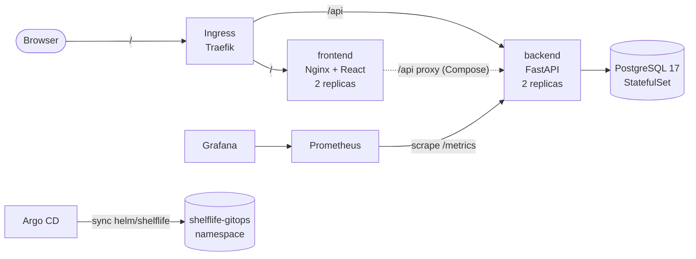
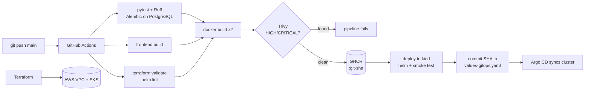

# ShelfLife: DevSecOps Capstone Project

[](https://github.com/Anushika06/ShelfLife-Devops-Capstone/actions/workflows/ci-cd.yml)

| | |
| --- | --- |
| **Student** | Anushika Chauhan |
| **Group** | Group-A |
| **Repository** | https://github.com/Anushika06/ShelfLife-Devops-Capstone |
| **Slide deck** | [`demo/presentation.pptx`](demo/presentation.pptx) · [`demo/slides.pdf`](demo/slides.pdf) |
| **Walkthrough video** | [`demo/shelflife-walkthrough.mp4`](https://youtu.be/a4cljmyVxSE) |
| **Evidence** | [`demo/evidence/`](demo/evidence/README.md) (26 screenshots) |

ShelfLife is a pantry and expiry tracker for a household's **fridge, freezer and pantry**. It answers one question first:

> **What should we use before it goes off?**

Each item has a storage location, a quantity, an optional use-by date and an optional low-stock threshold. The home screen places expired and soon-to-expire items on a **"Use these first"** shelf, and the inventory can be filtered by location, expiry status and search text.

The application is intentionally small. The project's focus is the delivery path around it: automated testing, containerisation, a gated CI/CD pipeline, image security scanning, infrastructure as code on AWS, Kubernetes with Helm, GitOps with Argo CD, and observability with Prometheus and Grafana.

---

## Contents

1. [Project Summary and Results](#1-project-summary-and-results)
2. [Architecture](#2-architecture)
3. [Technology Stack](#3-technology-stack)
4. [Application](#4-application)
5. [Running the Application Locally](#5-running-the-application-locally)
6. [Testing and Code Quality](#6-testing-and-code-quality)
7. [CI/CD Pipeline](#7-cicd-pipeline)
8. [Security (DevSecOps)](#8-security-devsecops)
9. [Infrastructure as Code: Terraform on AWS](#9-infrastructure-as-code-terraform-on-aws)
10. [Kubernetes and Helm](#10-kubernetes-and-helm)
11. [GitOps with Argo CD](#11-gitops-with-argo-cd)
12. [Observability: Prometheus and Grafana](#12-observability-prometheus-and-grafana)
13. [Configuration Reference](#13-configuration-reference)
14. [Known Issues and Limitations](#14-known-issues-and-limitations)
15. [Presentation, Video and Evidence](#15-presentation-video-and-evidence)
16. [Rubric Coverage](#16-rubric-coverage)

---

# 1. Project Summary and Results

The project was demonstrated in two environments, which are kept separate throughout this document:

| Environment | Purpose | What was demonstrated |
| --- | --- | --- |
| **Local Kubernetes (kind)** | Running the application on Kubernetes | Helm release with 2 backend + 2 frontend pods and PostgreSQL, Traefik Ingress, Argo CD GitOps sync, Prometheus scraping, Grafana dashboard |
| **AWS (Terraform)** | Provisioning cloud infrastructure as code | VPC with two public subnets and an EKS cluster with a managed node group (2 nodes Ready), followed by `terraform destroy` |

The application itself was **not** deployed to EKS; the EKS cluster demonstrates the Terraform infrastructure only.

| Area | Verified result | Evidence |
| --- | --- | --- |
| Application | React UI, FastAPI and PostgreSQL running with Docker Compose; all three containers healthy | E01, E02 |
| Testing | `pytest -v`: 17 of 17 tests passed on an isolated SQLite database | E04 |
| Git | Public repository; 20 commits on `main` (17 authored with conventional messages, 3 automated GitOps promotions) | E03, E05 |
| CI/CD | GitHub Actions run #2 on `main`: all 7 jobs succeeded in 4 m 2 s | E06 |
| Registry | Backend and frontend images in GHCR, tagged with the full commit SHA | E08 |
| Security | Trivy gate passed for both images: no fixable HIGH/CRITICAL vulnerabilities | E07 |
| Terraform | Plan: 16 to add; apply: 16 added in `ap-south-1`; destroy: 16 destroyed; leftover check clean | E09–E12 |
| Kubernetes (kind) | All pods Running, ClusterIP services, Ingress, Helm release `deployed` | E13–E16 |
| GitOps (kind) | Argo CD application Healthy and Synced to `main` | E17 |
| Observability (kind) | `/metrics` exposed; Prometheus targets 2/2 UP; Grafana dashboard populated | E18–E20 |

---

# 2. Architecture

## Runtime Architecture



The browser only calls relative URLs (`/api/...`), so one frontend build works in every environment:

* **Docker Compose:** Nginx in the frontend container proxies `/api` to the backend.
* **Kubernetes:** the Ingress routes `/api` to the backend Service and `/` to the frontend Service.

## Delivery Architecture



## Repository Layout

```text
.
├── backend/                  FastAPI service, Alembic migrations, pytest suite, Dockerfile
├── frontend/                 React + Vite UI, multi-stage Dockerfile, Nginx config
├── docker-compose.yml        PostgreSQL + backend + frontend
├── .github/workflows/        GitHub Actions CI/CD (ci-cd.yml)
├── terraform/                AWS VPC, subnets, IAM, EKS cluster and node group
├── k8s/                      Namespaces, kind cluster config, Traefik values
├── helm/shelflife/           Helm chart for the application
├── monitoring/               kube-prometheus-stack values (Prometheus, Grafana)
├── argocd/                   Argo CD Application manifest
├── scripts/                  Cluster setup, demo data, traffic and AWS cleanup checks
├── docs/                     Trivy scanning documentation
└── demo/                     Slide deck, PDF, walkthrough video and evidence screenshots
```

Folder documentation: [`backend/`](backend/README.md) · [`terraform/`](terraform/README.md) · [`helm/shelflife/`](helm/shelflife/README.md) · [`argocd/`](argocd/README.md) · [`monitoring/`](monitoring/README.md) · [`docs/TRIVY.md`](docs/TRIVY.md) · [`demo/evidence/`](demo/evidence/README.md)

---

# 3. Technology Stack

| Layer | Technology |
| --- | --- |
| Backend | Python 3.13, FastAPI 0.143, Uvicorn 0.54 |
| Frontend | React 19, Vite 8, responsive CSS |
| Database | PostgreSQL 17 |
| ORM and validation | SQLAlchemy 2.1, Pydantic 2.14 |
| Migrations | Alembic 1.20 |
| Testing and quality | pytest 9, httpx, Ruff |
| Containers | Docker, Docker Compose v2 |
| CI/CD | GitHub Actions |
| Registry | GitHub Container Registry (GHCR) |
| Security scanning | Trivy 0.75 |
| Infrastructure as code | Terraform ≥ 1.6, AWS provider 6.x |
| Cloud | AWS VPC, EKS 1.36, managed node group |
| Kubernetes (local) | kind, Kubernetes 1.36 |
| Packaging | Helm 4 |
| Ingress | Traefik 3.7 |
| GitOps | Argo CD 3.5 |
| Monitoring | kube-prometheus-stack (Prometheus Operator, Prometheus, Grafana) |

Application dependencies, base images, GitHub Actions and Helm chart versions are pinned in the repository.

---

# 4. Application

## Features

* Add, edit and remove pantry items stored in the fridge, freezer or pantry.
* Quantity and unit, optional use-by date, optional low-stock threshold and free-text notes.
* **"Use these first"** shelf for expired and soon-to-expire items.
* **"Use 1"** action that reduces the quantity (never below zero).
* Summary counts: total items, expired, expiring soon, running low.
* Location tabs and search across names and notes.
* Responsive layout down to phone width.
* Footer showing the deployed backend version (Git commit SHA).

Data entered in the UI flows through the FastAPI backend into PostgreSQL and persists across page refreshes.

## REST API

| Method | Endpoint | Purpose |
| --- | --- | --- |
| GET | `/health` | Liveness check |
| GET | `/ready` | Database and schema readiness |
| GET | `/metrics` | Prometheus metrics |
| GET | `/api/meta` | Service metadata and allowed values |
| GET | `/api/items` | List and filter items |
| GET | `/api/items/{id}` | Get one item |
| POST | `/api/items` | Create an item |
| PUT | `/api/items/{id}` | Replace an item |
| POST | `/api/items/{id}/consume` | Consume quantity |
| DELETE | `/api/items/{id}` | Delete an item |
| GET | `/api/summary` | Summary statistics |

Interactive API documentation is served at `/api/docs` (Swagger UI) and `/api/openapi.json`.

## Expiry Rules

* "Today" is evaluated in `APP_TIMEZONE` (default `Asia/Kolkata`).
* An item is **expiring** when its date falls within `EXPIRY_WARNING_DAYS` (default 3, inclusive).
* An item is **expired** once its date has passed.
* An item is **low-stock** when a threshold is set and `quantity <= min_quantity`.

## Database and Migrations

A single `pantry_items` table is managed entirely by Alembic; the application never calls `create_all()`.

```text
backend/alembic/versions/0001_create_pantry_items.py
backend/alembic/versions/0002_add_min_quantity.py
```

At container start-up the backend waits for PostgreSQL, applies `alembic upgrade head`, and then starts Uvicorn. A PostgreSQL advisory lock ensures that only one replica runs migrations when several start at the same time.

---

# 5. Running the Application Locally

## Prerequisites

| Tool | Required for |
| --- | --- |
| Docker Desktop / Docker Engine with Compose v2 | Local stack, image builds, kind |
| Python 3.13 | Backend and tests |
| Node.js 22.12+ | Frontend build |
| kind ≥ 0.33, kubectl, Helm 4 | Local Kubernetes |
| Terraform ≥ 1.6, AWS CLI v2 | AWS infrastructure |

The full local Kubernetes stack (application, Traefik, Prometheus, Grafana, Argo CD) needs about 8 GB of RAM available to Docker.

## Docker Compose

```bash
docker compose up --build
```

| URL | Purpose |
| --- | --- |
| http://localhost:3000 | ShelfLife UI |
| http://localhost:8000/health | Backend liveness |
| http://localhost:8000/api/docs | Swagger UI |
| http://localhost:8000/metrics | Prometheus metrics |

Compose starts PostgreSQL first, then the backend once the database is healthy, then the frontend once the backend is healthy. PostgreSQL is published on `127.0.0.1:55432`. Optional overrides are documented in `.env.example`.

```bash
scripts/seed-demo-data.sh      # load sample pantry items
docker compose down            # stop, keep the database volume
docker compose down -v         # stop and delete the database volume
```

**Verified result:** both images built, `shelflife-postgres-1` and `shelflife-backend-1` healthy, `shelflife-frontend-1` started, and the UI served at `http://localhost:3000` (E01, E02).

## Without Containers

```bash
docker compose up -d postgres

cd backend
python -m venv .venv && source .venv/bin/activate     # Windows: .venv\Scripts\activate
pip install -r requirements-dev.txt
cp .env.example .env
alembic upgrade head
uvicorn app.main:app --reload --port 8000

cd ../frontend
npm ci
npm run dev                                           # http://localhost:5173, proxies /api to the backend
```

---

# 6. Testing and Code Quality

```bash
cd backend
pip install -r requirements-dev.txt
ruff check .
ruff format --check .
pytest -v
```

## Test Isolation

`backend/tests/conftest.py` points the application at a temporary SQLite database before the app is imported, asserts that SQLite is in use, and recreates the tables around every test. The tests never touch the PostgreSQL development or production database. Configuration is in `backend/pytest.ini`.

## Test Suite

17 tests in four files:

| File | Covers |
| --- | --- |
| `test_items.py` | Create (201 and computed fields), validation errors, sorting by expiry, all filters, get by ID and 404, PUT replacement, consume with zero floor, delete |
| `test_summary.py` | Summary counts, empty pantry, expiry status boundaries, low-stock rule |
| `test_system.py` | `/health`, `/ready`, `/api/meta`, `/metrics` Prometheus format |
| `test_migrations.py` | Alembic upgrade and downgrade |

In CI, Alembic is additionally run `upgrade head → downgrade base → upgrade head` against a real PostgreSQL 17 service container.

**Verified result:** `pytest -v` collected 17 items, 17 passed (E04).

---

# 7. CI/CD Pipeline

Workflow file: [`.github/workflows/ci-cd.yml`](.github/workflows/ci-cd.yml)

Triggers: push to `main`, pull requests to `main`, and manual dispatch.

| # | Job | What it does | Gate |
| --- | --- | --- | --- |
| 1 | Backend: lint, pytest, migrations | Ruff lint and format check, `pytest -v`, Alembic up/down/up on PostgreSQL 17 | Any failure stops the pipeline |
| 2 | Frontend: npm build | `npm ci`, `npm run build`; `dist/` uploaded as an artifact | Build failure stops the pipeline |
| 3 | Terraform validate + Helm lint | `terraform fmt -check`, `init -backend=false`, `validate`; `helm lint` and `helm template` for every values file | Validation failure stops the pipeline |
| 4–5 | Image backend / Image frontend | Build each image tagged with the commit SHA, scan with Trivy, push to GHCR | Fixable HIGH/CRITICAL CVE fails the job before the push |
| 6 | Deploy to kind with Helm + smoke test | Temporary kind cluster, Traefik, `helm upgrade --install`, `helm test`, create/read/delete through the Ingress | Deployment or smoke-test failure stops promotion |
| 7 | GitOps: promote SHA for Argo CD | Writes the new image SHA into `helm/shelflife/values-gitops.yaml` and commits it | Runs only after a successful deployment |

Jobs 4–7 run their push, deploy and promote steps only for pushes to `main`; pull requests run the test, build and scan stages.

## Design Decisions

* **Immutable images:** images are tagged only with the full Git commit SHA, never `latest`. The Helm chart refuses to render without an explicit tag.
* **No stored registry credentials:** GHCR authentication uses the workflow's built-in `GITHUB_TOKEN`.
* **Ordered promotions:** runs on `main` are queued so GitOps promotions happen in commit order; superseded pull-request runs are cancelled.
* **No CI loop:** promotion commits are marked `[skip ci]` and are made with `GITHUB_TOKEN`, which does not trigger another workflow.

**Verified result:** [run #2 on `main`, commit `b728abc`](https://github.com/Anushika06/ShelfLife-Devops-Capstone/actions/runs/38564197363) completed all 7 jobs successfully in 4 m 2 s with 6 artifacts (E06). Both images were published to GHCR as `ghcr.io/anushika06/shelflife-backend:<sha>` and `ghcr.io/anushika06/shelflife-frontend:<sha>` (E08).

---

# 8. Security (DevSecOps)

## Trivy Image Scanning

Each image is scanned in CI before it is pushed:

```bash
trivy image --severity HIGH,CRITICAL --ignore-unfixed --exit-code 1 <image>:<git-sha>
```

* Only HIGH and CRITICAL findings are considered.
* Vulnerabilities without an available fix are excluded and re-checked on every build.
* Any remaining finding fails the job, so a vulnerable image is never pushed.
* The scan report is added to the workflow summary and uploaded as an artifact.

**Result (run #2, commit `b728abc`):** Trivy scanned the operating-system packages and the Python dependencies inside both images. The frontend image (Alpine 3.24.2) reported 0 vulnerabilities, and the backend scan step passed with `--exit-code 1`, with every Python package in the virtual environment reported as `0`. No fixable HIGH or CRITICAL vulnerability was found, so the gate passed and both images were published (E07).

During development, a local scan of the backend image found four HIGH findings in libraries vendored inside `pip` (urllib3, msgpack and setuptools metadata). The application never uses `pip` at runtime, so the Dockerfile removes `pip` and `ensurepip` from the runtime stage; the rebuilt image reported no HIGH/CRITICAL findings. Full details: [`docs/TRIVY.md`](docs/TRIVY.md).

## Container Hardening

| Image | Hardening |
| --- | --- |
| Backend | Multi-stage build on `python:3.13-slim`; runs as UID 10001; `pip` removed from the runtime image |
| Frontend | Multi-stage build: Node build stage, then `nginx-unprivileged` runtime as UID 101 on port 8080 |

## Kubernetes Security

* Application containers run as non-root with a read-only root filesystem, dropped Linux capabilities, no privilege escalation and the `RuntimeDefault` seccomp profile.
* Namespaces enforce the **baseline** Pod Security Standard and warn on **restricted**.

## Secrets Management

* No credentials are stored in the repository. `.env`, `terraform.tfvars`, Terraform state, plan files and kubeconfig files are excluded by `.gitignore`; only example templates are committed.
* AWS credentials are read by Terraform from the standard AWS CLI credential chain, never from files in the repository.
* The database password reaches the backend through a Kubernetes Secret; Grafana and Argo CD admin credentials are also held in Kubernetes Secrets.
* The values `change-me-local-only` (`.env.example`), `change-me-demo-only` (Helm `values.yaml`) and `ci-only-password` (CI service container) are non-secret placeholders for local, demo and CI use. The chart supports `postgres.auth.existingSecret` for real deployments.
* The Git history was scanned with gitleaks (all 20 commits) and searched for access keys, tokens, private keys, `.env` files and Terraform state: no secrets were found.

---

# 9. Infrastructure as Code: Terraform on AWS

Terraform in [`terraform/`](terraform/README.md) provisions the AWS infrastructure in `ap-south-1` (Mumbai).

| Resource | Configuration |
| --- | --- |
| VPC | `10.42.0.0/16`, DNS support and hostnames, internet gateway, public route table |
| Subnets | Two public subnets in two availability zones, tagged for EKS load balancers |
| IAM | Roles and policy attachments for the EKS control plane and worker nodes |
| EKS cluster | `shelflife-eks`, Kubernetes 1.36, standard support upgrade policy, public and private endpoint, API access entries |
| Node group | `shelflife-nodes`, Amazon Linux 2023, 20 GiB disk, on-demand; default 2 × `t3.medium` (min 1, max 3) |
| Budget alert | Optional AWS Budgets e-mail alert when `budget_alert_email` is set |

`terraform.tfvars.example` documents every input and contains no credentials.

## Cost-Driven Choices

* No NAT gateway: worker nodes run in public subnets.
* No CloudWatch control-plane logging.
* Local state instead of a remote backend.
* Kubernetes 1.36 in EKS standard support (older versions incur extended-support fees).
* Infrastructure destroyed immediately after the evidence was captured.

## Commands

```bash
cd terraform
cp terraform.tfvars.example terraform.tfvars
terraform init
terraform plan -out tfplan
terraform apply tfplan
aws eks update-kubeconfig --region ap-south-1 --name shelflife-eks
kubectl get nodes

terraform destroy
../scripts/aws-check-leftovers.sh ap-south-1      # read-only check for remaining resources
```

CI validates the configuration on every push (`terraform fmt -check`, `terraform init -backend=false`, `terraform validate`) without AWS credentials.

## Verified Result

| Step | Result | Evidence |
| --- | --- | --- |
| `terraform plan` | Plan: 16 to add, 0 to change, 0 to destroy | E09 |
| `terraform apply` | Apply complete: 16 added; outputs for cluster, VPC and subnets | E09 |
| AWS Console: VPC | `shelflife-vpc`, `10.42.0.0/16`, Available | E10 |
| AWS Console: subnets | `shelflife-public-ap-south-1a` (`10.42.0.0/20`) and `shelflife-public-ap-south-1b` (`10.42.16.0/20`) | E10 |
| AWS Console: EKS | Node group `shelflife-nodes` Active, Kubernetes 1.36, desired size 2 | E11 |
| `kubectl get nodes` | 2 nodes Ready (v1.36.4-eks) | E11 |
| `terraform destroy` | Destroy complete: 16 destroyed | E12 |
| `scripts/aws-check-leftovers.sh` | No EKS clusters, project VPCs, EC2 instances, load balancers, unattached volumes, Elastic IPs or NAT gateways left | E12 |

For this run the node instance type was set to `t3.small` in the local, git-ignored `terraform.tfvars`; the committed default is `t3.medium`.

---

# 10. Kubernetes and Helm

The application runs on a local **kind** cluster using the Helm chart in [`helm/shelflife/`](helm/shelflife/README.md). The same chart is validated in CI and deployed to a temporary kind cluster in every `main` pipeline run.

## Cluster Bootstrap

* `k8s/namespace.yaml` creates the `shelflife` (Helm CLI release) and `shelflife-gitops` (Argo CD release) namespaces.
* `k8s/kind-config.yaml` maps host port `8088` to the Traefik Ingress controller.
* `k8s/ingress-controller/` holds the Traefik values for kind and EKS.

## Helm Chart

| Resource | Details |
| --- | --- |
| Backend Deployment | 2 replicas; startup and liveness probe `/health`, readiness probe `/ready` |
| Frontend Deployment | 2 replicas; probe `/healthz` |
| PostgreSQL StatefulSet | 1 replica; 1 GiB PersistentVolumeClaim on kind |
| Services | ClusterIP for backend (8000), frontend (80) and PostgreSQL (5432) |
| Ingress | Traefik; `/api` → backend, `/` → frontend |
| Other | PodDisruptionBudgets, optional HPAs, ServiceMonitor, Grafana dashboard ConfigMap, `helm test` pod |

| Values file | Purpose |
| --- | --- |
| `values.yaml` | Defaults |
| `values-kind.yaml` | Local kind deployment (`shelflife.localtest.me`) |
| `values-local-images.yaml` | Locally built images loaded into kind |
| `values-eks.yaml` | EKS deployment settings |
| `values-gitops.yaml` | Argo CD release; image SHA updated by CI |

## Commands

The whole local stack (kind cluster, Traefik, kube-prometheus-stack, namespaces, ShelfLife release and Helm tests) is created by:

```bash
scripts/kind-up.sh --ghcr <github-owner> <git-sha>     # or: scripts/kind-up.sh --local
scripts/kind-down.sh                                    # remove the cluster
```

Equivalent manual installation of the application:

```bash
kubectl apply -f k8s/namespace.yaml
helm upgrade --install shelflife ./helm/shelflife -n shelflife \
  -f helm/shelflife/values-kind.yaml \
  --set backend.image.repository=ghcr.io/anushika06/shelflife-backend \
  --set backend.image.tag=<git-sha> \
  --set frontend.image.repository=ghcr.io/anushika06/shelflife-frontend \
  --set frontend.image.tag=<git-sha> \
  --wait
helm test shelflife -n shelflife
kubectl get pods,svc,ingress -n shelflife
helm list -n shelflife
```

Application URL on kind: `http://shelflife.localtest.me:8088`

## Verified Result (kind)

| Check | Result | Evidence |
| --- | --- | --- |
| `kubectl get pods -n shelflife` | 2 backend, 2 frontend and 1 PostgreSQL pod, all `Running` and `1/1` | E13 |
| `kubectl get svc -n shelflife` | `shelflife-backend`, `shelflife-frontend`, `shelflife-postgres`, all ClusterIP | E13, E14 |
| `kubectl get ingress -n shelflife` | Class `traefik`, host `shelflife.localtest.me` | E13 |
| `helm list -n shelflife` | Release `shelflife`, revision 1, `deployed`, chart `shelflife-0.1.0` | E15 |
| Browser through the Ingress | UI served at `http://shelflife.localtest.me:8088` | E16 |

---

# 11. GitOps with Argo CD

[`argocd/application.yaml`](argocd/README.md) defines the Argo CD Application `shelflife`:

* **Source:** this repository, branch `main`, path `helm/shelflife`, values file `values-gitops.yaml`.
* **Destination:** namespace `shelflife-gitops`.
* **Sync policy:** automated, with `prune` and `selfHeal`, so manual changes in the cluster are reverted to the state declared in Git.

## GitOps Flow

```text
git push to main
   → GitHub Actions: tests, build, Trivy scan, push to GHCR, kind deployment
   → gitops-promote job commits the new image SHA to helm/shelflife/values-gitops.yaml
   → Argo CD detects the new commit and rolls out the new images in shelflife-gitops
```

The Helm CLI release (`shelflife` namespace) and the Argo CD release (`shelflife-gitops` namespace) are separate.

## Commands

```bash
scripts/argocd-up.sh                                       # installs Argo CD v3.5.5 and applies the Application
kubectl -n argocd get applications
kubectl -n argocd port-forward svc/argocd-server 8443:443  # UI at https://localhost:8443
```

GitOps release URL on kind: `http://shelflife-gitops.localtest.me:8088`

**Verified result (kind):** Argo CD v3.5.5 shows the `shelflife` application **Healthy** and **Synced** to `main` at commit `18a0823` (the CI promotion commit for `b728abc`), with automated sync enabled and a resource tree of PostgreSQL, two backend pods, two frontend pods, their services and the Ingress (E17).

---

# 12. Observability: Prometheus and Grafana

## Application Metrics

The backend exposes Prometheus metrics at `/metrics`:

| Metric | Type | Labels |
| --- | --- | --- |
| `http_requests_total` | Counter | handler, method, status |
| `http_request_duration_seconds` | Histogram | handler, method |
| `shelflife_items_created_total` | Counter | location |
| `shelflife_items_consumed_total` | Counter | — |
| `shelflife_items_deleted_total` | Counter | — |
| `shelflife_pantry_items` | Gauge | status (`expired`, `expiring`, `fresh`, `no-date`, `low-stock`) |

Probe and metrics endpoints are excluded from the HTTP metrics so that dashboards reflect real API traffic.

## Monitoring Stack

[`monitoring/`](monitoring/README.md) contains the values for **kube-prometheus-stack** 92.3.1:

* Prometheus selects ServiceMonitors in all namespaces, keeps 2 days of data, and skips control-plane targets that kind does not expose.
* Grafana reads its admin credentials from the Kubernetes Secret `grafana-admin` and loads dashboards through the sidecar.
* The Helm chart ships a **ServiceMonitor** for the backend and the **ShelfLife API** Grafana dashboard (backend pods up, requests per second, error ratio, p95 latency, requests by endpoint, responses by status class, p50/p95/p99 latency, pantry items by status, pantry actions per minute).

```bash
helm upgrade --install monitoring prometheus-community/kube-prometheus-stack --version 92.3.1 \
  -n monitoring -f monitoring/prometheus-values.yaml -f monitoring/grafana-values.yaml --wait --timeout 10m
kubectl -n monitoring port-forward svc/monitoring-kube-prometheus-prometheus 9090:9090
kubectl -n monitoring port-forward svc/monitoring-grafana 3001:80
scripts/generate-traffic.sh http://shelflife.localtest.me:8088 180
```

Ingress URLs on kind: `http://prometheus.localtest.me:8088/targets` and `http://grafana.localtest.me:8088`.

## Verified Result (kind)

| Check | Result | Evidence |
| --- | --- | --- |
| `curl /metrics` | `http_requests_total` and `shelflife_*` series returned in Prometheus format | E18 |
| Prometheus Targets | `serviceMonitor/shelflife/shelflife-backend/0` and `serviceMonitor/shelflife-gitops/shelflife-backend/0`, each 2/2 **UP** | E19 |
| Grafana "ShelfLife API" | 2 backend pods up, 0.199 req/s, p95 latency 99.7 ms; endpoint, status-class, latency and pantry-status panels populated | E20 |

---

# 13. Configuration Reference

## Backend Environment Variables

| Variable | Default | Purpose |
| --- | --- | --- |
| `DATABASE_URL` | — | Full SQLAlchemy URL (takes precedence over `DB_*`) |
| `DB_HOST` / `DB_PORT` / `DB_NAME` | `localhost` / `5432` / `shelflife` | PostgreSQL location |
| `DB_USER` / `DB_PASSWORD` | `shelflife` / empty | PostgreSQL credentials |
| `DB_WAIT_SECONDS` | `60` | Start-up wait for PostgreSQL |
| `EXPIRY_WARNING_DAYS` | `3` | Expiry warning window |
| `APP_TIMEZONE` | `Asia/Kolkata` | Determines "today" |
| `CORS_ORIGINS` | `http://localhost:5173` | Allowed origins |
| `ENVIRONMENT` | `local` | Runtime environment label |
| `APP_VERSION` | `dev` | Version shown in the UI (commit SHA in CI builds) |

## Other Configuration

| Component | Location |
| --- | --- |
| Frontend Nginx upstream | `BACKEND_URL` (default `http://backend:8000`) |
| Docker Compose overrides | `.env.example` |
| Terraform inputs | `terraform/variables.tf`, `terraform/terraform.tfvars.example` |
| Helm values | `helm/shelflife/values*.yaml` |
| Monitoring values | `monitoring/*.yaml` |

---

# 14. Known Issues and Limitations

* **Application not deployed to EKS:** the Kubernetes, Argo CD, Prometheus and Grafana results come from the local kind cluster. The EKS cluster was provisioned with Terraform, verified with two Ready nodes, and destroyed. `values-eks.yaml` is provided but was not used for a recorded deployment.
* **Database durability:** PostgreSQL runs as a single-replica StatefulSet without backups. On kind it uses a 1 GiB PersistentVolumeClaim; `values-eks.yaml` disables persistence because the EBS CSI driver is not installed by Terraform. A production deployment would use Amazon RDS or persistent storage with backups.
* **Terraform state:** state is stored locally. A team setup would use a remote backend with locking.
* **Network design:** worker nodes use public subnets to avoid NAT gateway cost; production designs would place them in private subnets.
* **Infrastructure scan findings:** `trivy config` reports five HIGH/CRITICAL items in `terraform/main.tf`, all accepted cost/demo trade-offs: the EKS API endpoint is public and `cluster_endpoint_public_access_cidrs` defaults to `0.0.0.0/0`, Kubernetes secrets are not envelope-encrypted with KMS, and the public subnets assign public IPs. Helm, Kubernetes and Dockerfile configurations have no HIGH/CRITICAL findings.
* **GitOps promotion:** the pipeline commits the promotion directly to `main`; a protected-branch setup would use pull requests.
* **Metrics freshness:** the `shelflife_pantry_items` gauge refreshes when `/api/summary` is called.
* **Grafana error panel:** the error-ratio panel shows *No data* until a 4xx/5xx response has been recorded; `scripts/generate-traffic.sh` deliberately requests a missing item to produce 404 responses.
* **Local DNS:** the `*.localtest.me` hostnames must resolve to `127.0.0.1`; if they do not, add them to the hosts file.
* **Windows:** shell scripts are intended for Bash or WSL.

---

# 15. Presentation, Video and Evidence

## Deliverables in `demo/`

| Deliverable | Location |
| --- | --- |
| Presentation video (MP4) | [`demo/shelflife-walkthrough.mp4`](https://youtu.be/a4cljmyVxSE) |
| Slide deck (PowerPoint, 19 slides) | [`demo/presentation.pptx`](demo/presentation.pptx) |
| Slide deck (PDF) | [`demo/slides.pdf`](demo/slides.pdf) |
| Evidence screenshots | [`demo/evidence/`](demo/evidence/README.md) |

The slide deck covers the project overview, technology stack, architecture diagram, codebase and local run, testing, CI/CD flow, DevSecOps, Terraform and AWS, Kubernetes and Helm, GitOps, observability, alternatives and trade-offs, results and key learnings. AWS account IDs are masked in the slide copies of the console screenshots.

## Walkthrough Coverage

The walkthrough follows the order required by `SUBMISSION.md`:

| # | Topic | Supporting evidence |
| --- | --- | --- |
| 1 | Slides: what was built and the architecture | `demo/presentation.pptx` |
| 2 | Codebase: folder structure and key files | E03 |
| 3 | CI/CD: push to `main` and GitHub Actions run | E06, E07, E08 |
| 4 | Terraform: `terraform plan` and AWS Console (VPC + EKS) | E09–E12 |
| 5 | Argo CD: synced application and GitOps flow | E17 |
| 6 | Kubernetes: pods, services and Ingress | E13–E16 |
| 7 | Prometheus: Targets page with the application UP | E19 |
| 8 | Grafana: live dashboard with application metrics | E20 |

## Evidence Index

All screenshots were captured from real runs on 14–15 October 2026.

| ID | File | Shows |
| --- | --- | --- |
| E01 | [`E01-app-browser.png`](demo/evidence/E01-app-browser.png) | UI at `http://localhost:3000` |
| E02 | [`E02-docker-compose-up.png`](demo/evidence/E02-docker-compose-up.png) | `docker compose up --build`, three healthy containers |
| E03 | [`E03-github-repo-codebase.png`](demo/evidence/E03-github-repo-codebase.png) | Repository, README, passing CI badge |
| E04 | [`E04-pytest.png`](demo/evidence/E04-pytest.png) | `pytest -v`: 17 passed |
| E05 | [`E05-commit-history.png`](demo/evidence/E05-commit-history.png) | Commit history |
| E06 | [`E06-github-actions-green.png`](demo/evidence/E06-github-actions-green.png) | Successful pipeline run on `main` |
| E07 | [`E07-trivy-scan-backend.png`](demo/evidence/E07-trivy-scan-backend.png), [`E07-trivy-scan-frontend.png`](demo/evidence/E07-trivy-scan-frontend.png) | Trivy scan steps for both images |
| E08 | [`E08-ghcr-packages-backend.png`](demo/evidence/E08-ghcr-packages-backend.png), [`E08-ghcr-packages-frontend.png`](demo/evidence/E08-ghcr-packages-frontend.png) | GHCR packages with SHA tags |
| E09 | [`E09-terraform-plan.png`](demo/evidence/E09-terraform-plan.png), [`E09-terraform-apply.png`](demo/evidence/E09-terraform-apply.png) | `terraform plan` and `apply` |
| E10 | [`E10-aws-vpc.png`](demo/evidence/E10-aws-vpc.png), [`E10-aws-subnets.png`](demo/evidence/E10-aws-subnets.png) | VPC and two public subnets |
| E11 | [`E11-aws-eks.png`](demo/evidence/E11-aws-eks.png), [`E11-aws-eks-nodes.png`](demo/evidence/E11-aws-eks-nodes.png) | EKS node group and Ready nodes |
| E12 | [`E12-terraform-destroy.png`](demo/evidence/E12-terraform-destroy.png), [`E12-aws-leftovers-check.png`](demo/evidence/E12-aws-leftovers-check.png) | `terraform destroy` and leftover check |
| E13 | [`E13-kubernetes-resources.png`](demo/evidence/E13-kubernetes-resources.png) | Pods, services and Ingress (kind) |
| E14 | [`E14-kubernetes-services.png`](demo/evidence/E14-kubernetes-services.png) | ClusterIP services (kind) |
| E15 | [`E15-helm-release.png`](demo/evidence/E15-helm-release.png) | `helm list` (kind) |
| E16 | [`E16-app-via-ingress.png`](demo/evidence/E16-app-via-ingress.png) | Application through the Ingress (kind) |
| E17 | [`E17-argocd-synced.png`](demo/evidence/E17-argocd-synced.png) | Argo CD Synced and Healthy (kind) |
| E18 | [`E18-metrics-endpoint.png`](demo/evidence/E18-metrics-endpoint.png) | `/metrics` output |
| E19 | [`E19-prometheus-targets-up.png`](demo/evidence/E19-prometheus-targets-up.png) | Prometheus targets UP (kind) |
| E20 | [`E20-grafana-dashboard.png`](demo/evidence/E20-grafana-dashboard.png) | Grafana dashboard (kind) |

---

# 16. Rubric Coverage

| Module | Requirement | Implementation | Evidence |
| --- | --- | --- | --- |
| M1 Application | FastAPI `/health`; ≥ 4 REST endpoints (GET, POST, PUT, DELETE); PostgreSQL with Alembic; React UI | `backend/app/`, `backend/alembic/versions/`, `backend/requirements.txt`, `frontend/`, `docker-compose.yml` | E01 |
| M2 Testing | `pytest` passes; ≥ 5 tests across ≥ 3 endpoints; test database; `pytest.ini`/`conftest.py` | 17 tests in `backend/tests/` on SQLite; `backend/pytest.ini`, `backend/tests/conftest.py` | E04 |
| M3 Git and GitHub | Public repository; meaningful commits; `.gitignore` covers `.env`, `__pycache__`, `node_modules`, `.venv` | Conventional commit history; `.gitignore` also covers Terraform state and kubeconfig | E03, E05 |
| M4 Docker | Backend Dockerfile; multi-stage frontend (Node + Nginx); non-root images; `docker compose up --build` | `backend/Dockerfile` (UID 10001), `frontend/Dockerfile` (UID 101), `docker-compose.yml` | E01, E02 |
| M5 CI/CD | Workflow on push to `main`; pytest gate; frontend build; both images; GHCR; SHA tags | `.github/workflows/ci-cd.yml` | E06, E08 |
| M6 Trivy | Scan both images in CI; fail on HIGH/CRITICAL; explanation | `images` job; [`docs/TRIVY.md`](docs/TRIVY.md) | E07 |
| M7 Terraform | Valid HCL; `init`; non-empty plan; VPC with 2 public subnets; EKS with node group; destroy; `terraform.tfvars.example` | `terraform/` | E09–E12 |
| M8 Kubernetes + Helm | `k8s/namespace.yaml`; Helm chart; `helm upgrade --install`; 2+ replicas each; ClusterIP services; Ingress `/` and `/api`; pods Running | `k8s/`, `helm/shelflife/` (kind) | E13–E16 |
| M9 Observability | `/metrics`; Prometheus scraping; Grafana accessible; live application panels | `backend/app/metrics.py`, `monitoring/`, ServiceMonitor and dashboard in the chart (kind) | E18–E20 |
| M10 Presentation + Documentation | Root README; walkthrough video and slide deck in `demo/` | This README; `demo/presentation.pptx`, `demo/slides.pdf`, `demo/shelflife-walkthrough.mp4` | — |
| Video: Argo CD | Synced application and GitOps flow | `argocd/application.yaml`, `helm/shelflife/values-gitops.yaml`, `gitops-promote` job | E17 |

---

## Summary

ShelfLife is a small, complete three-tier application carried through a full DevSecOps workflow:

```text
React + FastAPI + PostgreSQL
   → pytest and Ruff quality gates
   → multi-stage, non-root Docker images
   → GitHub Actions CI/CD with commit-SHA tags
   → Trivy security gate
   → GHCR
   → Helm on Kubernetes (kind) with Traefik Ingress
   → Argo CD GitOps
   → Prometheus and Grafana
   + Terraform-provisioned AWS VPC and EKS (provisioned, verified and destroyed)
```