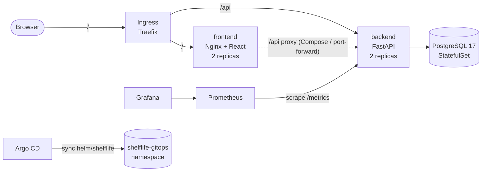
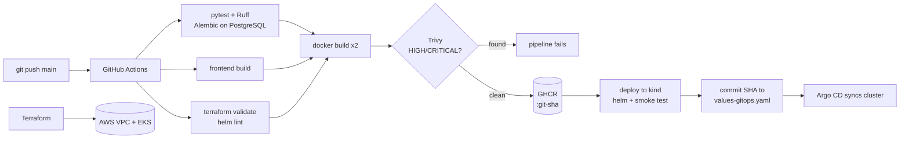

# ShelfLife

[](https://github.com/Anushika06/ShelfLife-Devops-Capstone/actions/workflows/ci-cd.yml)

A pantry and expiry tracker, delivered through a complete DevSecOps pipeline: from a laptop to a monitored Kubernetes deployment.

ShelfLife keeps track of what is in a household's **fridge, freezer and pantry**, and answers one question first:

> **What should we use before it goes off?**

Every item has a storage location, quantity, an optional use-by date and an optional low-stock threshold. The home screen puts everything that is expired or close to its date on a **"Use these first"** shelf. The inventory can be filtered by location, expiry status and search text.

The application is deliberately small. The engineering focus is on taking it through **testing, containerisation, CI/CD, security scanning, infrastructure as code, Kubernetes, GitOps and observability**.

---

## Contents

1. [Architecture](#1-architecture)
2. [Tech Stack](#2-tech-stack)
3. [The Application](#3-the-application)
4. [Running Locally](#4-running-locally)
5. [Testing and Code Quality](#5-testing-and-code-quality)
6. [CI/CD Pipeline](#6-cicd-pipeline)
7. [Security](#7-security)
8. [Infrastructure as Code](#8-infrastructure-as-code-terraform-on-aws)
9. [Kubernetes and Helm](#9-kubernetes-and-helm)
10. [GitOps with Argo CD](#10-gitops-with-argo-cd)
11. [Observability](#11-observability)
12. [Configuration Reference](#12-configuration-reference)
13. [Known Issues and Limitations](#13-known-issues-and-limitations)
14. [Presentation and Evidence](#14-presentation-and-evidence)

---

# 1. Architecture

## Runtime Architecture



The browser only calls relative URLs (`/api/...`), so the same frontend build works in every environment:

* **Docker Compose:** Nginx proxies `/api` to the backend.
* **Kubernetes:** Ingress sends `/api` to the backend Service and `/` to the frontend Service.

## Delivery Architecture



## Repository Layout

```text
.
├── backend/                  FastAPI service
│   ├── app/                  main.py, config.py, db.py, models.py,
│   │                         schemas.py, domain.py, metrics.py,
│   │                         prestart.py, routers/
│   ├── alembic/versions/     Database migrations
│   ├── tests/                pytest suite and conftest.py
│   ├── Dockerfile            Multi-stage, non-root image
│   ├── docker-entrypoint.sh  Waits for PostgreSQL, runs migrations
│   └── requirements*.txt     Runtime and development dependencies
├── frontend/                 React + Vite UI
├── docker-compose.yml        PostgreSQL + backend + frontend
├── .github/workflows/        GitHub Actions CI/CD
├── terraform/                AWS infrastructure
├── k8s/                      Kubernetes bootstrap manifests
├── helm/shelflife/           Helm chart
├── monitoring/               Prometheus/Grafana configuration
├── argocd/                   Argo CD Application
├── scripts/                  Deployment and demo scripts
├── docs/                     Documentation
└── demo/                     Presentation and evidence
```

---

# 2. Tech Stack

| Layer        | Technology                                 |
| ------------ | ------------------------------------------ |
| Backend      | Python 3.13, FastAPI 0.143, Uvicorn 0.54   |
| Frontend     | React 19, Vite 8, responsive CSS           |
| Database     | PostgreSQL 17                              |
| ORM          | SQLAlchemy 2.1                             |
| Validation   | Pydantic 2.14                              |
| Migrations   | Alembic 1.20                               |
| Metrics      | Prometheus + prometheus-client             |
| Testing      | pytest 9, httpx                            |
| Code Quality | Ruff                                       |
| Containers   | Docker, Docker Compose v2                  |
| CI/CD        | GitHub Actions                             |
| Registry     | GitHub Container Registry (GHCR)           |
| Security     | Trivy 0.75                                 |
| IaC          | Terraform ≥ 1.6                            |
| Cloud        | AWS VPC + EKS                              |
| Kubernetes   | kind, Kubernetes 1.36                      |
| Packaging    | Helm 4                                     |
| Ingress      | Traefik 3.7                                |
| GitOps       | Argo CD 3.5                                |
| Monitoring   | kube-prometheus-stack, Prometheus, Grafana |

All application dependencies, base images, GitHub Actions and Helm chart versions are pinned in the repository.

---

# 3. The Application

## Features

* Add, edit and remove pantry items.
* Storage locations:

  * Fridge
  * Freezer
  * Pantry
* Track quantity and unit.
* Optional use-by date.
* Optional low-stock threshold.
* Notes for each item.
* **"Use these first"** shelf for expired and soon-to-expire items.
* **"Use 1"** action to reduce quantity.
* Quantity never goes below zero.
* Summary counts for:

  * Total items
  * Expired
  * Expiring soon
  * Running low
* Location tabs.
* Search across names and notes.
* Responsive layout down to phone width.
* Footer displays the deployed backend version / Git commit SHA.

## REST API

| Method | Endpoint                  | Purpose                             |
| ------ | ------------------------- | ----------------------------------- |
| GET    | `/health`                 | Liveness check                      |
| GET    | `/ready`                  | Database/schema readiness           |
| GET    | `/metrics`                | Prometheus metrics                  |
| GET    | `/api/meta`               | Service metadata and allowed values |
| GET    | `/api/items`              | List and filter items               |
| GET    | `/api/items/{id}`         | Get one item                        |
| POST   | `/api/items`              | Create an item                      |
| PUT    | `/api/items/{id}`         | Replace an item                     |
| POST   | `/api/items/{id}/consume` | Consume quantity                    |
| DELETE | `/api/items/{id}`         | Delete an item                      |
| GET    | `/api/summary`            | Summary statistics                  |

Swagger UI is available at:

```text
/api/docs
```

OpenAPI schema:

```text
/api/openapi.json
```

## Expiry Rules

* "Today" is evaluated using `APP_TIMEZONE`.
* Default timezone: `Asia/Kolkata`.
* An item is considered expiring when its date is within `EXPIRY_WARNING_DAYS`.
* Default expiry warning window: **3 days**, inclusive.
* An item is expired once its date has passed.
* An item is low-stock when a threshold is configured and:

```text
quantity <= min_quantity
```

## Database and Migrations

The application uses a single `pantry_items` table managed by Alembic.

Migrations include:

```text
0001_create_pantry_items
0002_add_min_quantity
```

The application does not call `create_all()`.

At container startup:

1. PostgreSQL availability is checked.
2. Alembic migrations are executed.
3. Uvicorn starts.
4. PostgreSQL advisory locking prevents multiple replicas from migrating simultaneously.

---

# 4. Running Locally

## Prerequisites

| Tool                           | Required For                   |
| ------------------------------ | ------------------------------ |
| Docker Desktop / Docker Engine | Compose, image builds and kind |
| Docker Compose v2              | Local stack                    |
| Git                            | Source control                 |
| Python 3.13+                   | Backend and tests              |
| Node.js 22.12+                 | Frontend                       |
| kind ≥ 0.33                    | Local Kubernetes               |
| kubectl                        | Kubernetes management          |
| Helm 4                         | Kubernetes deployment          |
| Terraform ≥ 1.6                | AWS infrastructure             |
| AWS CLI v2                     | AWS infrastructure             |

For the full local Kubernetes stack, Docker should have at least **8 GB RAM** available.

### GitHub Repository Setup

If you fork the repository, replace the GitHub placeholders:

```bash
scripts/set-github-repo.sh <github-owner> <repo-name>
```

This updates the repository references used by:

* Argo CD
* Helm values
* GitOps values
* CI/CD badge

---

## Option A: Docker Compose

Recommended for local development.

```bash
docker compose up --build
```

Services:

| URL                            | Purpose            |
| ------------------------------ | ------------------ |
| http://localhost:3000          | ShelfLife UI       |
| http://localhost:8000/health   | Backend liveness   |
| http://localhost:8000/api/docs | Swagger UI         |
| http://localhost:8000/metrics  | Prometheus metrics |

Compose starts services in order:

```text
PostgreSQL
    ↓
Backend
    ↓
Frontend
```

### Load Demo Data

```bash
scripts/seed-demo-data.sh
```

### Stop the Application

Keep the database volume:

```bash
docker compose down
```

Delete the database volume:

```bash
docker compose down -v
```

### Environment Configuration

Copy the example environment file:

```bash
cp .env.example .env
```

Edit `.env` as required.

PostgreSQL is published on:

```text
127.0.0.1:55432
```

rather than the default `5432`.

---

## Option B: Run Backend and Frontend Without Containers

### Start PostgreSQL

```bash
cp .env.example .env
docker compose up -d postgres
```

### Backend

```bash
cd backend

python -m venv .venv
source .venv/bin/activate
```

Windows:

```powershell
.venv\Scripts\activate
```

Install dependencies:

```bash
pip install -r requirements-dev.txt
```

Configure environment:

```bash
cp .env.example .env
```

Run migrations:

```bash
alembic upgrade head
```

Start FastAPI:

```bash
uvicorn app.main:app --reload --port 8000
```

### Frontend

In another terminal:

```bash
cd frontend
npm ci
npm run dev
```

The frontend will be available at:

```text
http://localhost:5173
```

The Vite development server proxies `/api` requests to the backend.

---

# 5. Testing and Code Quality

From the backend directory:

```bash
cd backend
pip install -r requirements-dev.txt
```

Run Ruff:

```bash
ruff check .
```

Check formatting:

```bash
ruff format --check .
```

Run tests:

```bash
pytest -v
```

## Test Isolation

Tests use an isolated SQLite database.

The test configuration:

* Creates a temporary SQLite database.
* Verifies that the application is using SQLite.
* Recreates tables around every test.
* Never touches the PostgreSQL development database.

## Test Coverage

The test suite contains **17 tests** covering:

* `/health`
* `/ready`
* `/api/meta`
* `/metrics`
* Item creation
* Validation errors
* Whitespace trimming
* Sorting
* All item filters
* Get-by-ID
* 404 handling
* PUT replacement
* Item consumption
* Quantity zero floor
* Invalid consumption amounts
* Delete
* Summary counts
* Expiry boundaries
* Low-stock boundaries
* Alembic migration upgrade/downgrade

CI additionally tests:

```text
upgrade head
    ↓
downgrade base
    ↓
upgrade head
```

against PostgreSQL 17.

---

# 6. CI/CD Pipeline

Workflow:

```text
.github/workflows/ci-cd.yml
```

Triggers:

* Push to `main`
* Pull requests to `main`
* Manual dispatch

## Pipeline Stages

### 1. Backend Tests

Runs:

```text
Ruff lint
Ruff format check
pytest
Alembic upgrade/down/up
```

Any failure stops the pipeline.

### 2. Frontend Build

```bash
npm ci
npm run build
```

The generated `dist/` directory is uploaded as an artifact.

### 3. Infrastructure Validation

Terraform:

```bash
terraform fmt -check
terraform init -backend=false
terraform validate
```

Helm:

```bash
helm lint
helm template
```

Every values file is validated.

### 4. Container Images

Two images are built:

```text
shelflife-backend
shelflife-frontend
```

Images are tagged with the full Git commit SHA:

```text
:<git-sha>
```

Images are pushed to GHCR only for successful `main` builds.

### 5. Trivy Security Gate

Each image is scanned before publishing.

Fixable `HIGH` or `CRITICAL` vulnerabilities fail the pipeline.

### 6. kind Deployment

CI creates a temporary kind cluster and:

1. Installs Traefik.
2. Deploys the Helm chart.
3. Runs Helm tests.
4. Performs create/read/delete smoke tests through Ingress.

### 7. GitOps Promotion

After successful deployment:

```text
values-gitops.yaml
```

is updated with the new image SHA.

Argo CD then detects the Git change and deploys the new version.

## CI/CD Design Principles

### Immutable Images

Images use commit SHA tags instead of `latest`.

The Helm chart requires an explicit image tag.

### No Stored Registry Credentials

GHCR authentication uses GitHub's built-in `GITHUB_TOKEN`.

### Ordered Promotions

Main branch runs are queued so GitOps promotions happen in commit order.

Pull-request runs cancel superseded runs.

### No CI Loop

Promotion commits use:

```text
[skip ci]
```

and GitHub token commits do not trigger another workflow.

After a successful promotion:

```bash
git pull --rebase
```

before the next push.

---

# 7. Security

## Trivy Image Scanning

Images are scanned with:

```bash
trivy image \
  --severity HIGH,CRITICAL \
  --ignore-unfixed \
  --exit-code 1 \
  <image>:<git-sha>
```

The scan:

* Reports HIGH and CRITICAL vulnerabilities.
* Ignores vulnerabilities without available fixes.
* Fails the build when fixable vulnerabilities remain.
* Runs before the image is pushed.

The scan output is also included in the workflow summary and uploaded as an artifact.

## Container Hardening

### Backend

Runs as:

```text
UID 10001
```

### Frontend

Uses:

```text
nginx-unprivileged
UID 101
port 8080
```

## Kubernetes Security

Pods use:

* `runAsNonRoot`
* Read-only root filesystem
* Dropped Linux capabilities
* No privilege escalation
* `RuntimeDefault` seccomp profile

Namespaces enforce the baseline Pod Security Standard and warn on restricted settings.

## Secrets

Sensitive values are not committed to Git.

Ignored files include:

```text
.env
terraform.tfvars
terraform.tfstate
kubeconfig
```

Only example templates are committed.

Database passwords are provided through Kubernetes Secrets.

Grafana and Argo CD credentials are also stored in Kubernetes Secrets.

> The Helm default database password `change-me-demo-only` is for demonstrations only. Production deployments should use an existing Kubernetes Secret.

---

# 8. Infrastructure as Code — Terraform on AWS

Terraform provisions AWS infrastructure in `ap-south-1` by default.

## Resources

### VPC

```text
CIDR: 10.42.0.0/16
```

Includes:

* DNS support
* DNS hostnames
* Internet Gateway
* Public route table

### Subnets

Two public subnets across two Availability Zones.

### EKS

* Kubernetes 1.36
* Public + private endpoint
* API access entries
* Creator receives admin access
* Standard upgrade policy

### Node Group

Default:

```text
2 × t3.medium
```

Configuration:

```text
Minimum: 1
Maximum: 3
OS: Amazon Linux 2023
Disk: 20 GiB
Capacity: ON_DEMAND
```

SPOT capacity is optional.

### Budget Alert

An AWS Budget email alert can be created by setting:

```text
budget_alert_email
```

## Cost-Driven Choices

The project deliberately avoids:

* NAT Gateway
* CloudWatch control-plane logging
* Remote Terraform backend

Worker nodes run in public subnets to reduce infrastructure cost.

> The EKS control-plane fee continues while the cluster exists. Review current AWS pricing before applying the Terraform configuration.

## Deploy

```bash
cd terraform

cp terraform.tfvars.example terraform.tfvars
```

Confirm the AWS account:

```bash
aws sts get-caller-identity
```

Initialize:

```bash
terraform init
```

Create a plan:

```bash
terraform plan -out tfplan
```

Apply:

```bash
terraform apply tfplan
```

Configure kubectl:

```bash
aws eks update-kubeconfig \
  --region ap-south-1 \
  --name shelflife-eks
```

Verify:

```bash
kubectl get nodes
```

## Important Terraform Settings

Review:

```text
kubernetes_version
cluster_endpoint_public_access_cidrs
node_capacity_type
node_desired_size
budget_alert_email
```

Restrict the Kubernetes API CIDR to your own IP where possible:

```text
x.x.x.x/32
```

## Teardown

Remove Kubernetes resources that may create AWS resources first:

```bash
helm uninstall shelflife -n shelflife || true
helm uninstall traefik -n traefik || true
```

Check for LoadBalancer services:

```bash
kubectl get svc -A | grep LoadBalancer
```

Then:

```bash
cd terraform
terraform destroy
```

Finally:

```bash
cd ..
scripts/aws-check-leftovers.sh ap-south-1
```

The leftover-check script performs read-only checks for:

* EKS clusters
* Project-tagged VPCs
* EKS-tagged EC2 instances
* Load balancers
* Unattached EBS volumes
* Elastic IPs
* NAT gateways

---

# 9. Kubernetes and Helm

## Local kind Cluster

Build and load local images:

```bash
scripts/kind-up.sh --local
```

Or use images already published to GHCR:

```bash
scripts/kind-up.sh --ghcr <github-owner> <git-sha>
```

The script:

1. Creates a kind cluster.
2. Maps host port `8088` to the Ingress controller.
3. Installs Traefik.
4. Installs kube-prometheus-stack.
5. Creates namespaces.
6. Installs the ShelfLife Helm chart.
7. Runs Helm tests.
8. Prints access URLs.

Remove the cluster:

```bash
scripts/kind-down.sh
```

## Manual Installation

Create the cluster:

```bash
kind create cluster \
  --name shelflife \
  --config k8s/kind-config.yaml
```

Add Helm repositories:

```bash
helm repo add traefik https://traefik.github.io/charts
helm repo add prometheus-community https://prometheus-community.github.io/helm-charts
helm repo update
```

Install Traefik:

```bash
helm upgrade --install traefik traefik/traefik \
  --version 41.7.1 \
  -n traefik \
  --create-namespace \
  -f k8s/ingress-controller/traefik-values-kind.yaml \
  --wait
```

Install monitoring:

```bash
kubectl create namespace monitoring

kubectl -n monitoring create secret generic grafana-admin \
  --from-literal=admin-user=admin \
  --from-literal=admin-password='<choose-a-password>'
```

```bash
helm upgrade --install monitoring \
  prometheus-community/kube-prometheus-stack \
  --version 92.3.1 \
  -n monitoring \
  -f monitoring/prometheus-values.yaml \
  -f monitoring/grafana-values.yaml \
  --wait \
  --timeout 10m
```

Install ShelfLife:

```bash
kubectl apply -f k8s/namespace.yaml

helm upgrade --install shelflife ./helm/shelflife \
  -n shelflife \
  -f helm/shelflife/values-kind.yaml \
  --set backend.image.repository=ghcr.io/<owner>/shelflife-backend \
  --set backend.image.tag=<git-sha> \
  --set frontend.image.repository=ghcr.io/<owner>/shelflife-frontend \
  --set frontend.image.tag=<git-sha> \
  --wait
```

Run Helm tests:

```bash
helm test shelflife -n shelflife
```

Check resources:

```bash
kubectl get pods,svc,ingress -n shelflife
helm list -n shelflife
```

Application URL:

```text
http://shelflife.localtest.me:8088
```

## Helm Chart Resources

The chart deploys:

* Backend Deployment — 2 replicas
* Frontend Deployment — 2 replicas
* PostgreSQL StatefulSet
* Backend Service
* Frontend Service
* PostgreSQL Service
* Traefik Ingress
* PodDisruptionBudgets
* Optional HPAs
* ServiceMonitor
* Grafana dashboard
* Helm test Pod

Backend probes:

```text
startup: /health
liveness: /health
readiness: /ready
```

Frontend probe:

```text
/healthz
```

The chart requires explicit image tags and will not render with an implicit `latest`.

## Helm Values Files

| File                       | Purpose                    |
| -------------------------- | -------------------------- |
| `values.yaml`              | Default configuration      |
| `values-kind.yaml`         | Local kind deployment      |
| `values-local-images.yaml` | Locally loaded kind images |
| `values-eks.yaml`          | EKS deployment             |
| `values-gitops.yaml`       | Argo CD deployment         |

---

# 10. GitOps with Argo CD

Install Argo CD:

```bash
scripts/argocd-up.sh
```

Check applications:

```bash
kubectl -n argocd get applications
```

Port-forward the Argo CD server:

```bash
kubectl -n argocd port-forward svc/argocd-server 8443:443
```

Access:

```text
https://localhost:8443
```

Retrieve the initial password:

```bash
kubectl -n argocd get secret argocd-initial-admin-secret \
  -o jsonpath='{.data.password}' | base64 -d
echo
```

## GitOps Flow

```text
1. Developer pushes to main
          ↓
2. GitHub Actions runs
          ↓
3. Images are built and scanned
          ↓
4. kind deployment succeeds
          ↓
5. values-gitops.yaml receives the new SHA
          ↓
6. Argo CD detects the Git change
          ↓
7. Argo CD rolls out the new version
          ↓
8. UI footer shows the new version
```

Argo CD has automated:

* Sync
* Pruning
* Self-healing

A manual Kubernetes change is reverted to the state declared in Git.

## Prerequisites

Before running Argo CD:

* `argocd/application.yaml` must contain the repository URL.
* At least one green CI run must have populated `values-gitops.yaml`.
* GHCR packages must be public or accessible using an image pull secret.

Application URL:

```text
http://shelflife-gitops.localtest.me:8088
```

The Helm CLI release and Argo CD release are deliberately kept separate.

---

# 11. Observability

## Metrics

The backend exposes:

```text
/metrics
```

Metrics include:

| Metric                           | Type      | Labels                  |
| -------------------------------- | --------- | ----------------------- |
| `http_requests_total`            | Counter   | handler, method, status |
| `http_request_duration_seconds`  | Histogram | handler, method         |
| `shelflife_items_created_total`  | Counter   | location                |
| `shelflife_items_consumed_total` | Counter   | —                       |
| `shelflife_items_deleted_total`  | Counter   | —                       |
| `shelflife_pantry_items`         | Gauge     | status                  |

The pantry status gauge tracks:

```text
expired
expiring
fresh
no-date
low-stock
```

Probe and metrics endpoints are excluded from HTTP traffic metrics so the dashboard reflects real API traffic.

## Prometheus + Grafana

The project uses:

```text
kube-prometheus-stack
```

with:

* Prometheus Operator
* Prometheus
* Grafana

Prometheus:

* Selects ServiceMonitors across namespaces.
* Uses 2-day retention.
* Disables unnecessary control-plane targets.

Grafana credentials are loaded from:

```text
grafana-admin
```

The bundled **ShelfLife API** dashboard displays:

* Backend pods up
* Requests per second
* Error ratio
* p95 latency
* Requests by endpoint
* Responses by status class
* p50/p95/p99 latency
* Pantry items by status
* Pantry actions per minute

## Access

Prometheus:

```text
http://prometheus.localtest.me:8088/targets
```

Grafana:

```text
http://grafana.localtest.me:8088
```

Retrieve the Grafana password:

```bash
kubectl -n monitoring get secret grafana-admin \
  -o jsonpath='{.data.admin-password}' | base64 -d
echo
```

Generate traffic for the dashboard:

```bash
scripts/generate-traffic.sh \
  http://shelflife.localtest.me:8088 \
  180
```

## Port-Forward Fallback

Prometheus:

```bash
kubectl -n monitoring port-forward \
  svc/monitoring-kube-prometheus-prometheus \
  9090:9090
```

Grafana:

```bash
kubectl -n monitoring port-forward \
  svc/monitoring-grafana \
  3001:80
```

---

# 12. Configuration Reference

## Backend Environment Variables

| Variable              | Default                 | Purpose                        |
| --------------------- | ----------------------- | ------------------------------ |
| `DATABASE_URL`        | —                       | Full SQLAlchemy connection URL |
| `DB_HOST`             | `localhost`             | PostgreSQL host                |
| `DB_PORT`             | `5432`                  | PostgreSQL port                |
| `DB_NAME`             | `shelflife`             | Database name                  |
| `DB_USER`             | `shelflife`             | Database user                  |
| `DB_PASSWORD`         | empty                   | Database password              |
| `DB_WAIT_SECONDS`     | `60`                    | PostgreSQL startup wait        |
| `EXPIRY_WARNING_DAYS` | `3`                     | Expiry warning window          |
| `APP_TIMEZONE`        | `Asia/Kolkata`          | Determines "today"             |
| `CORS_ORIGINS`        | `http://localhost:5173` | Allowed origins                |
| `ENVIRONMENT`         | `local`                 | Runtime environment            |
| `APP_VERSION`         | `dev`                   | Git commit SHA / version       |

`DATABASE_URL` takes precedence over the individual `DB_*` settings.

## Frontend

The Nginx container uses:

```text
BACKEND_URL
```

Default:

```text
http://backend:8000
```

## Docker Compose

Compose configuration is documented in:

```text
.env.example
```

## Terraform

Terraform configuration is documented in:

```text
terraform/variables.tf
terraform/terraform.tfvars.example
```

---

# 13. Known Issues and Limitations

* The project uses **Traefik** instead of the archived `kubernetes/ingress-nginx` project.
* Uvicorn uses the `h11` HTTP implementation because of issues observed with `httptools`.
* PostgreSQL on EKS is **ephemeral** in the demo configuration.
* The Terraform configuration does not install the EBS CSI driver.
* Production deployments should use Amazon RDS or persistent EBS-backed PostgreSQL.
* In-cluster PostgreSQL is a single replica without backups.
* Terraform state is stored locally.
* Production teams should use a remote Terraform backend with locking.
* Worker nodes use public subnets to avoid NAT Gateway costs.
* Production infrastructure would normally use private subnets with NAT.
* The `shelflife_pantry_items` gauge refreshes when `/api/summary` is called.
* `*.localtest.me` requires DNS resolution to `127.0.0.1`.
* GitOps promotion commits directly to `main`; protected branches would require a pull request.
* Windows may not preserve executable permissions on shell scripts.

If `localtest.me` does not resolve, add:

```text
127.0.0.1 shelflife.localtest.me
127.0.0.1 shelflife-gitops.localtest.me
127.0.0.1 grafana.localtest.me
127.0.0.1 prometheus.localtest.me
```

---

# 14. Presentation and Evidence

The repository includes supporting presentation and demonstration material.

## Presentation

```text
demo/presentation.pptx
```

Contains:

* Project architecture
* CI/CD pipeline
* Infrastructure
* Kubernetes
* GitOps
* Observability
* Trade-offs
* Learnings

## Evidence

```text
demo/evidence/
```

Contains screenshots from real project runs, including:

* GitHub Actions
* GHCR
* Trivy
* Terraform
* AWS Console
* Kubernetes
* Argo CD
* Prometheus
* Grafana

## Screenshot Checklist

```text
demo/SCREENSHOT_CHECKLIST.md
```

Documents what each evidence screenshot demonstrates and how it was captured.

## Video Demo Script

```text
demo/VIDEO_DEMO_SCRIPT.md
```

Contains the recommended order and commands for the project walkthrough.

## Walkthrough Video

```text
demo/shelflife-walkthrough.mp4
```

Added once the recording is complete.

## Trivy Documentation

```text
docs/TRIVY.md
```

Contains the image scanning approach and results.

---

## Summary

ShelfLife is intentionally small as an application, but demonstrates a complete modern DevSecOps workflow:

```text
React + FastAPI
       ↓
PostgreSQL
       ↓
Docker
       ↓
Automated Testing
       ↓
GitHub Actions
       ↓
Trivy Security Scanning
       ↓
GHCR
       ↓
Kubernetes / kind
       ↓
Helm
       ↓
AWS EKS
       ↓
Argo CD GitOps
       ↓
Prometheus + Grafana
```

The result is a complete path from **local development → testing → secure containerisation → CI/CD → Kubernetes → GitOps → cloud infrastructure → observability**.